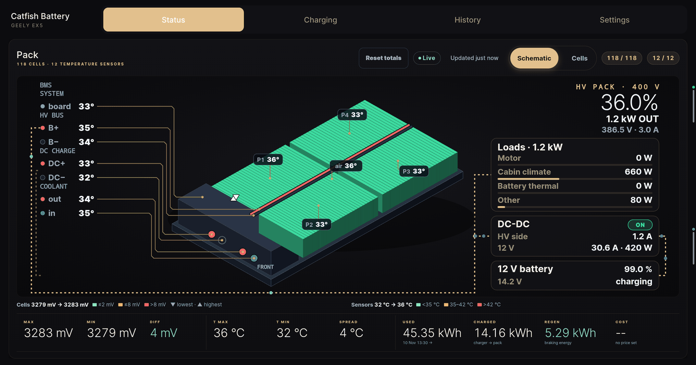
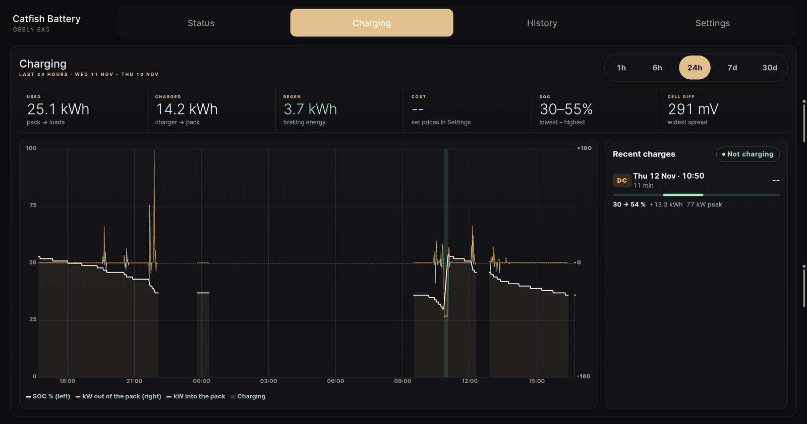
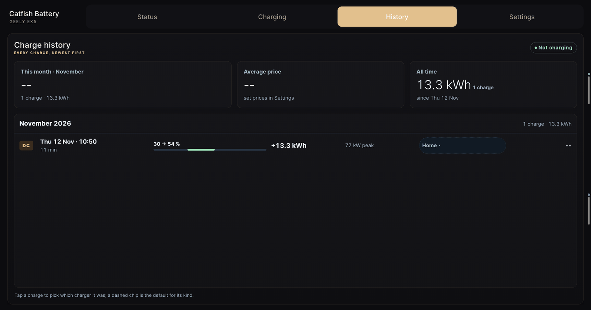
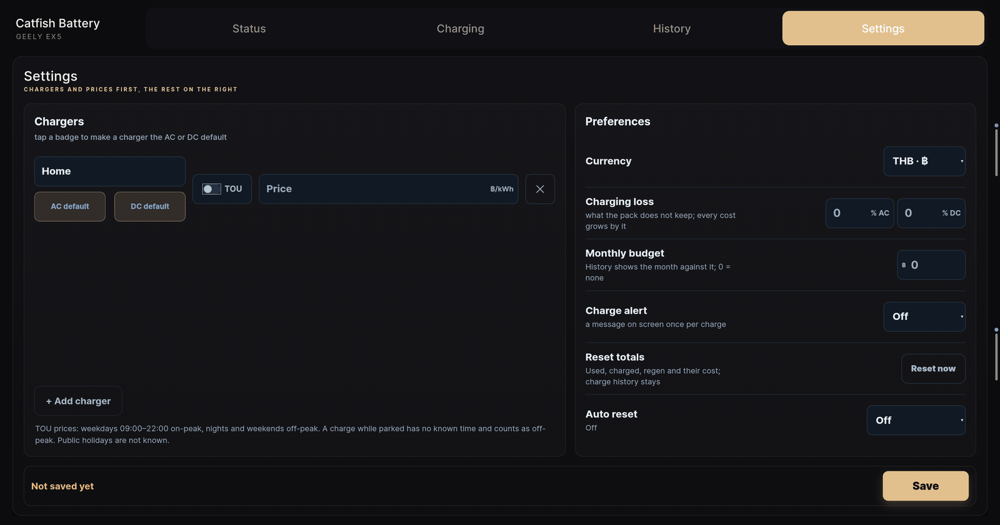

# Catfish Battery

A standalone battery monitor for the Geely EX5 head unit: live pack status,
charging graphs, a charge log with costs, and the settings behind them.



| | |
|---|---|
| **Package** | `com.catfish.battery` |
| **Version** | 1.4 (`versionCode` 5) on this branch; latest release is [1.3](https://github.com/Antony-12s/CatfishBattery/releases) |
| **Android** | 11+ (`minSdk` 30), built for the EX5 2560x1600 head unit |
| **Vehicle access** | Read-only. It never writes vehicle properties |

## What it shows

### Status
The 3D pack schematic with all 118 cell voltages and 12 temperature sensors,
live pack power, where that power goes (motor, cabin climate, battery thermal,
other), the DC-DC converter and the 12 V battery. A **Cells** view lists every
cell. The bottom row keeps energy totals: used, charged and regen.

### Charging



SOC and pack power over 1 h, 6 h, 24 h, 7 d or 30 d, with charge sessions
highlighted, plus the recent charges with their SOC range, energy and peak kW.

### History



Every charge, newest first, grouped by month. Tap a charge to pick which
charger it was, so its cost uses that charger's price. Monthly totals compare
against an optional budget.

### Settings



- Chargers with a flat price or time-of-use prices, and AC/DC defaults
- Currency, charging losses, monthly budget and a charge-level alert
- **Reset totals**: clears the used, charged and regen totals and their cost
  now. Charge history and settings are kept.
- **Auto reset**: off, every month, or every N months (2-12) on a chosen day.
  "Last day" follows the length of each month. The next reset date shows
  after Save.

Screenshots were taken on the car (firmware 1.3) on 12 Nov 2026, with the
system bars cropped out. The values are real readings from that moment.

## How it works

The app reads the head unit's VHAL (`localhost:40004`) and APVP
(`localhost:40005`) streams. A foreground service logs every 10 s while the
head unit is on, and starts again on boot. If the head unit sleeps through a
scheduled reset, the reset runs once on wake. The app works independently of
Custom Profiles (CF), which stays unchanged.

## Install

Download the APK and `SHA256SUMS` from
[Releases](https://github.com/Antony-12s/CatfishBattery/releases). APKs are
release assets only, never committed to the source tree.

Update in place with `adb install -r` for the active Android user (user 11 on
the EX5), only while parked. **Never uninstall or clear data to work around a
signing mismatch**: that deletes the charge history.

Firmware 1.3 rejects adb installs with `INSTALL_FAILED_VERIFICATION_FAILURE`
while `verifier_verify_adb_installs` is 1. Set it to 0 for the install only,
and restore the earlier value in the same shell script.

## Build

Requires an Android SDK with platform 33, JDK 17+ (JDK 21 tested) and network
access for the Gradle dependencies. Gradle 8.14.4 comes with the wrapper. No CF
checkout or signing credentials are included.

```sh
export ANDROID_HOME="$HOME/Android/Sdk"
export JAVA_HOME=/usr/lib/jvm/java-21-openjdk-amd64
./gradlew :battery:testDebugUnitTest :battery:assembleRelease :battery:lintRelease
```

Output: `battery/build/outputs/apk/release/catfish_battery_<version>_release.apk`.
See [UI checks](battery/tools/README.md) for the browser and emulator checks.

### Signing

The release variant uses the local Android debug keystore, the same one used
for the car build. **Each machine's debug key is different**, so a build from
another machine cannot update the installed app unless it is signed with the
original key. No private key is in this repository.

Release signing certificate SHA-256 (1.2 to 1.4):

```text
77ed0ffb4263c5a7ac30002cc79825c03068fc390eee0e446daf53ca2df37e46
```

Compare the installed and candidate signers before updating.

## Verification (1.4)

- 56 unit tests, 0 failures. Release build passes.
- Android lint: 0 errors, 15 warnings.
- Installed on the car over 1.3 with `-r`. All four tabs open and show live
  data. The reset buttons were not pressed on the car.

Not verified: an automatic reset firing on the car, a real charge logged by
1.4, and long-term survival through the head unit's sleep (STR) policy.

## Known limits

- CF charge history is not migrated; Catfish keeps its own files and settings.
- Metrics the car does not report stay `--`. There is no root-based range probe.
- Background logging can stop when the head unit sleeps.
- Costs need charger prices in Settings.

## Project layout

| Path | Contents |
|---|---|
| `battery/src/main/java/com/catfish/battery/` | App source: data readers, logger, pages |
| `battery/src/test/` | Unit tests |
| `battery/tools/` | Page export and UI checks |
| `docs/screenshots/` | Car screenshots used in this README |
| [DECISIONS.md](DECISIONS.md) | Scope and design decisions |
| [NOTICE.md](NOTICE.md) | Source provenance |

This private extraction does not establish a new code license.
